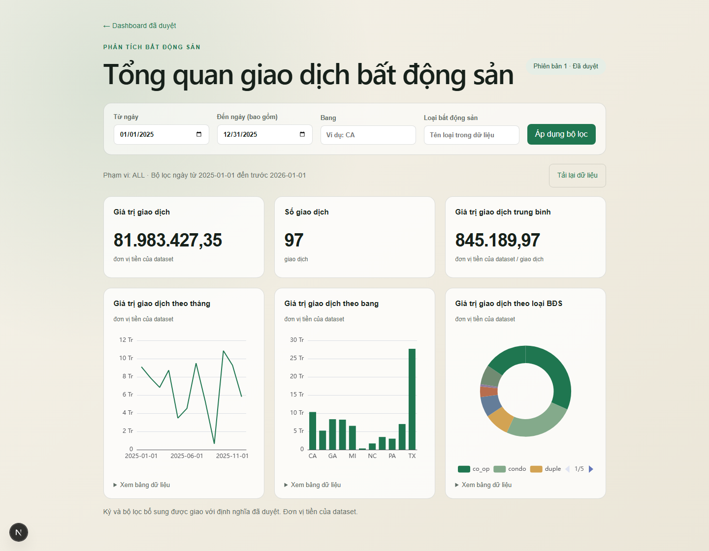

# AI Dashboard Agent — Real Estate MVP

Demo đã triển khai trên AWS Lightsail với Docker Compose, PostgreSQL và HTTPS. Xem [hướng dẫn triển khai](docs/vps-deploy.md).

## Trải nghiệm demo

**Website:** https://aidashboardncc.duckdns.org

| Tài khoản Viewer công khai | Giá trị |
| --- | --- |
| Username | `viewer` |
| Password | `hehehehehehe` |

Viewer chỉ xem dữ liệu mẫu và thử bộ lọc. Để trải nghiệm **AI tạo/chỉnh dashboard bằng tiếng Việt**, dùng Builder demo riêng:

| Tài khoản Builder demo công khai | Giá trị |
| --- | --- |
| Username | `builder_demo` |
| Password | `BuilderDemo2026!AI` |

Web hiện dùng **`LLM_MODE=live`, `gpt-6-luna` qua OpenAI Responses API**. Vào **AI Builder**, nhập “Tạo dashboard tổng giá trị giao dịch theo bang năm 2025”, rồi thử “Thêm số lượng đề nghị mua bất động sản”. Bản nháp chỉ xuất hiện cho Viewer sau khi bấm **Duyệt và phát hành**.

Đây là tài khoản dùng chung: hội thoại/dashboard không riêng tư, không nhập dữ liệu nhạy cảm. Builder demo chỉ sửa dashboard do tài khoản này sở hữu; Builder cá nhân vẫn được giữ riêng. Giới hạn: 1 lượt đang chạy, 6 yêu cầu/phút, 30 hội thoại/ngày và 1 LLM call/lượt. Ngân sách dự trù LLM **dùng chung toàn ứng dụng $0,10/ngày** (giờ Việt Nam); hết hạn mức thì tạm dừng gọi AI, dashboard đã duyệt vẫn xem được. API key không nằm trong trình duyệt hoặc repository.

Ứng dụng local gồm Next.js App Router ở cổng 3000 và FastAPI ở cổng 8000. Đã có auth, bảy KPI sales/offers/repairs, compiler SQL allowlist, executor read-only theo scope, dashboard với bộ lọc/ECharts và Builder tạo/chỉnh draft qua hội thoại. Có durable checkpoint, khôi phục sau restart, API/UI duyệt hoặc từ chối và phát hành phiên bản idempotent. Đã kiểm chứng DB chính, bộ test PostgreSQL/browser, benchmark LLM thật và gate chất lượng theo review ngữ nghĩa được duyệt; xem trạng thái bàn giao mới nhất trong [kế hoạch](IMPLEMENTATION_PLAN.md) và [báo cáo nghiệm thu](docs/acceptance-report.md). Health không cần database.



*Ảnh từ demo công khai: giao diện vàng nhạt, dữ liệu mẫu tổng hợp và phạm vi ALL. Viewer có thể thử bộ lọc ngày, bang và loại bất động sản.*

## Yêu cầu

- Windows PowerShell 5.1+ hoặc PowerShell 7.
- Python 3.11 (project chấp nhận `>=3.11,<3.13`).
- Node.js `>=20.9.0`; đã kiểm tra với Node 22.
- PostgreSQL chưa cần để chạy health check P1-T01.
- Chế độ mock không cần LLM API key; chế độ live cần key, model và giá đã xác minh.

## Thiết lập lần đầu

Chạy từ thư mục repository:

```powershell
py -3.11 -m venv .venv
Copy-Item backend/.env.example backend/.env
Copy-Item frontend/.env.example frontend/.env.local

.\.venv\Scripts\python.exe -m pip install --requirement backend/requirements.lock

Push-Location frontend
npm ci
Pop-Location
```

Không commit `backend/.env`, `frontend/.env.local`, `.venv`, backup hoặc log. Các dependency Python và npm đã được pin trong lockfile; dùng `npm ci`, không dùng install không khóa phiên bản trong quy trình tái lập.

Chỉ copy file env khi thiết lập mới; nếu đã có cấu hình, giữ file hiện tại và đối chiếu những biến mới trong `.env.example`. PostgreSQL và các tài khoản runtime/reader là bắt buộc cho đăng nhập/dashboard; chỉ health check chạy độc lập DB. Xem [local runbook](docs/local-runbook.md) trước migration hoặc restore.

Để kiểm chứng lại setup trong snapshot và virtualenv mới, dùng Git CLI và chạy:

```powershell
.\.venv\Scripts\python.exe backend/scripts/verify_clean_setup.py --e2e
```

Script lấy source hiện tại kể cả thay đổi chưa commit, bỏ env thật/dependency/runtime cũ, cài từ hai lockfile, sinh API types, chạy unit/lint/build/typecheck rồi PostgreSQL test và Playwright. Snapshot/log/report được giữ trong `backend/.runtime/clean-setup-*`. Thư mục đang làm việc và DB đang có được giữ nguyên. Registry/proxy từ biến môi trường được giữ; cấu hình pip đích cài đặt bị loại và pip.ini bị tắt để chỉ cài vào virtualenv mới. Wheel/npm/browser cache của máy có thể được dùng lại; đây là kiểm chứng dependency mới trên cùng máy, không phải máy/OS mới. Không có `--e2e` thì chỉ chạy tới build/typecheck.

## Chạy local

```powershell
.\scripts\start-local.ps1
```

Nếu đã dùng quy trình cấp bốn login local trong [runbook](docs/local-runbook.md),
dùng `.\scripts\start-local.ps1 -UseProvisionedRoles` để nạp URL từ artifact
bảo vệ mà không đưa secret vào lệnh. Sau khi seed demo, bốn username là
`builder_all`, `viewer_all`, `viewer_ca`, `builder_tx`; mật khẩu chỉ nằm trong
`backend/.runtime/local-demo-accounts.env` bị Git ignore. Không gửi file này
hoặc mật khẩu vào chat/GitHub.

Script kiểm tra config/dependency, chạy FastAPI ẩn ở `127.0.0.1:8000`, chờ health thành công rồi chạy Next.js ở `127.0.0.1:3000`. Nhấn `Ctrl+C` để dừng frontend; script sẽ dừng backend do chính nó tạo.

Mở:

- UI: <http://localhost:3000>
- Health trực tiếp: <http://localhost:8000/api/health>
- Health cùng origin qua Next.js: <http://localhost:3000/api/health>

`/api/:path*` được Next.js chuyển tiếp nguyên đường dẫn đến `BACKEND_URL`. Browser không gọi trực tiếp cổng 8000.

## Chạy từng service

Backend:

```powershell
Push-Location backend
..\.venv\Scripts\python.exe -m uvicorn app.main:app --host 127.0.0.1 --port 8000 --reload
Pop-Location
```

Frontend:

```powershell
Push-Location frontend
npm run dev
Pop-Location
```

## Kiểm tra P1-T01

```powershell
$env:APP_ENV = 'test'
.\.venv\Scripts\python.exe -c "from fastapi.testclient import TestClient; from backend.app.main import app; r=TestClient(app).get('/api/health'); assert r.status_code == 200; print(r.json())"
Remove-Item Env:APP_ENV

Push-Location frontend
$env:BACKEND_URL = 'http://127.0.0.1:8000'
npm run lint
npm run typecheck
npm run build
Remove-Item Env:BACKEND_URL
Pop-Location
```

Kiểm tra lỗi config rõ ràng:

- Thiếu `APP_ENV` và không có `backend/.env`: backend dừng với validation error chỉ rõ field `app_env` bị thiếu.
- Thiếu `BACKEND_URL` và không có `frontend/.env.local`: Next.js dừng với thông báo hướng dẫn copy `.env.example`.

## Dữ liệu và bằng chứng

- Import nguồn: `data/real-estate-sales-sample-database-v3-sql-postgres.sql` — không tự động import hoặc sửa.
- Audit và từ điển: `docs/data-audit.md`, `docs/data-dictionary.md`.
- KPI/golden fixtures: `docs/kpi-catalog.md`, `backend/tests/fixtures/`.
- Bộ 30 câu đánh giá và report template: `backend/tests/evaluation/prompts.json`, `docs/acceptance-report.md`.

DB chính đã được audit và đối chiếu 16 bảng/2.203 dòng; xem bằng chứng trong `docs/data-audit.md`. Khi dùng database khác, chạy lại audit bằng credential phù hợp trước khi áp dụng baseline này.

## Kiểm thử PostgreSQL riêng, không cần cấu hình credential thủ công

Nếu đã cài PostgreSQL 16 trên Windows, chạy từ repository:

```powershell
.\.venv\Scripts\python.exe backend/scripts/test_local_postgres.py
```

Script tạo cluster mới trong `backend/.runtime/`, chỉ nghe loopback ở cổng trống, tự sinh password và tách role migration/runtime/ALL/CA/TX. Script import dataset mẫu vào database nguồn riêng, tạo custom-format backup, restore database test, rồi chạy migration upgrade/downgrade/upgrade và kiểm thử auth/RLS/executor/dashboard API. PostgreSQL test được dừng trong `finally`; dữ liệu/log/backup được giữ trong thư mục ignored để kiểm tra. Script không dùng credential hoặc database của service PostgreSQL đang có. Có thể chỉ định vị trí binary bằng `--postgres-bin`.

Bộ test còn kiểm tra graph checkpoint/interrupt bằng cách dừng và khởi động uvicorn thật, khôi phục draft cùng thread và kiểm tra resume không lặp LLM/query. Runtime MVP chạy **một backend process**: cơ chế nhận diện run bị ngắt dùng process epoch, chưa hỗ trợ nhiều worker backend đồng thời. Run timeout mặc định 120 giây; trong cùng process, recovery chỉ nhận run hết timeout cộng 30 giây. Sau restart, run trước preview được báo `run_interrupted`; preview đã checkpoint được khôi phục tại bước chờ duyệt. Không tự chạy lại plan/query bị ngắt.

Để kiểm tra cả trình duyệt:

```powershell
Push-Location frontend
npx playwright install chromium
Pop-Location
.\.venv\Scripts\python.exe backend/scripts/test_local_postgres.py --e2e
```

Chế độ này tự seed tài khoản và dashboard demo, chạy frontend/backend ở cổng trống, chạy Playwright rồi dừng các process do nó tạo. Không cần gửi hoặc lưu password demo vào source. Đây là bằng chứng trên DB test từ import, chưa thay thế audit `real_estate_db` đang dùng.

Full browser suite cần chạy qua runner trên: các test recovery dùng control file trong thư mục artifact ignored để runner restart **process backend do chính nó tạo**, không có endpoint restart trong ứng dụng. Reader outage đổi cổng reader CA sang cổng loopback không có server; provider outage dùng factory test-only và `LLM_MODE=mock`, không gọi nhà cung cấp thật. Factory từ chối môi trường ngoài test/mock. Runner kiểm row count/content fingerprint của cả 16 bảng source trước/sau và ghi `source-integrity.json`; ledger `public.alembic_version` là metadata, không tính vào source.

`DATABASE_CONNECT_TIMEOUT_SECONDS` mặc định 3 giây, nhận 2–5 giây; áp dụng cho kết nối DB và chờ checkout pool runtime/reader. Query analytics và kiểm principal reader có statement timeout tối đa 5 giây. Connect failure trả lỗi dữ liệu đã làm sạch; không chờ vô hạn trước khi thiết lập statement timeout.

## Dashboard đã duyệt và demo không cần LLM

Trong `/builder`, tạo hoặc chỉnh bản nháp rồi chọn **Duyệt và phát hành** hoặc **Từ chối bản nháp**. Chỉ Builder sở hữu được quyết định. Người xem tiếp tục đọc bản cũ đến khi phiên bản mới commit; dữ liệu được tính lại theo scope người xem. Từ chối không tạo phiên bản. Sau quyết định, có thể tiếp tục hội thoại để tạo bản nháp tiếp theo.

API `POST /api/conversations/{id}/approval` nhận `decision` (`approve`/`reject`), `draft_revision`, `draft_hash` và `base_version_number` (bắt buộc, `null` cho dashboard mới). Giá trị phải lấy nguyên từ preview hiện tại. Revision/hash/base cũ trả 409. Nếu dashboard có phiên bản mới từ một hội thoại khác, mở bản đã duyệt để bắt đầu hội thoại mới. Retry đúng quyết định trả cùng dashboard/version. Khi `checkpoint_synced=false`, quyết định/phát hành đã commit; chọn **Hoàn tất xử lý** để resume graph trước khi chỉnh tiếp. Không tạo phiên bản mới khi retry.

Sau khi cấu hình/migrate DB local theo runbook và seed người dùng, tạo dashboard demo bằng CLI:

```powershell
.\.venv\Scripts\python.exe backend/scripts/seed_dashboard.py --owner builder_all --confirm-demo
```

CLI tạo một bản đã duyệt với ba card và ba chart; chạy lại giữ nguyên phiên bản đã có. CLI này chỉ phục vụ demo trước luồng HITL, không có endpoint bỏ qua duyệt trong runtime. Mở `/dashboards`; mỗi lần lọc/tải lại, API chạy theo scope của người đang xem. Viewer không nhận SQL chi tiết và không thể sửa spec qua API. Ngày/bang/loại bổ sung được giao với bộ lọc đã lưu, không nới rộng chúng.

Executor mặc định `statement_timeout=5000ms`, tối đa 1.000 dòng và planner cost `10000`; timeout/row limit có hard upper bounds trong Settings. Cost là đơn vị của PostgreSQL planner, không phải tiền hoặc thời gian. Bảng tiền trả qua API dưới dạng chuỗi Decimal; lỗi query trả mã riêng và không trả một phần kết quả khi vượt dòng.

## Adapter, ngân sách và hội thoại

Hướng dẫn bật `gpt-6-luna` local và kiểm thử API thật: [Live MVP](docs/live-mvp.md). Web công khai dùng profile ngân sách/throttle riêng: [trạng thái deployment](docs/deployment-status.md).

`LLM_MODE=mock` không cần key và dùng tập quy tắc deterministic phục vụ phát triển. `LLM_MODE=live` yêu cầu toàn bộ cấu hình provider/HTTPS endpoint/model/key/pricing trong `.env.example`; chưa có model hoặc giá mặc định. Không coi mock là bằng chứng chất lượng LLM thật.

Adapter OpenAI dùng Responses structured output, không tự retry, không gửi raw dataset/query results. `UsageService` giữ chỗ chi phí/token trong `app.usage_calls` trước mỗi call, dùng khóa Builder cho hạn mức ngày và đối soát idempotent sau call. Timeout/usage thiếu giữ nguyên phần dự trù. Mặc định 3 calls, 24.000 token, 60 giây/run, 0,10 USD/run và 1 USD/ngày theo giờ Việt Nam. Giá phải bao phủ rate cao nhất áp dụng (cache-write/tier/region nếu có), là ước tính chứ không phải hóa đơn.

Builder mở `/builder` từ danh sách dashboard; Viewer không được gọi API hội thoại. Ba endpoint hiện có: `POST /api/conversations`, `GET /api/conversations/{id}`, `POST /api/conversations/{id}/messages`. Thread/run ID do server tạo; request thứ hai khi đang running nhận 409. Lịch sử prompt được giới hạn; query được validate toàn bộ trước khi chạy. Chỉnh draft dùng bounded operations thay vì thay toàn bộ spec, giữ widget không liên quan. Chỉ dùng lại kết quả trong cùng hội thoại khi plan/catalog/scope khớp; đổi scope vô hiệu toàn bộ dữ liệu cũ. Khi hỏi lại, preview hợp lệ trước đó vẫn được giữ nếu scope còn khớp.

Chuỗi thử mock: tạo “Tổng quan giao dịch năm 2025” → “Lọc California” → “Đổi biểu đồ theo loại bất động sản thành cột ngang” → “Thêm số bất động sản có giao dịch” → “Bỏ biểu đồ theo bang” → “Đổi khoảng thời gian năm 2024”. Kiểm tra preview và diff, rồi bấm **Duyệt và phát hành** để Viewer xem phiên bản chính thức; **Từ chối** giữ nguyên phiên bản đã duyệt trước đó. Live adapter đã có bằng chứng browser/benchmark và đánh giá 30 câu: raw 21/30, valid 19/20, 10/10 câu hỏi lại/từ chối đạt theo review ngữ nghĩa được duyệt. Strict exact-match gate vẫn false; chi tiết tại `docs/live-eval-review.md`.

Để chạy evaluator qua auth/API/graph và SQL tham chiếu độc lập trong DB test:

```powershell
.\.venv\Scripts\python.exe backend/scripts/test_local_postgres.py --e2e --evaluate
```

Report `mock-full-evaluation.json` nằm trong thư mục artifact của cluster test, báo đúng PASS/FAIL/BLOCKED và không coi mock là release gate. Corpus đầy đủ có 20 valid, 5 ambiguous và 5 unsupported; đã bật cả case offers/repairs. Mỗi query/metric thực thi, kể cả query không gắn widget, được so với SQL trực tiếp trên fact độc lập compiler; tính đúng số liệu và tính đúng câu hỏi được báo riêng. Text câu hỏi/giải thích được so bảo thủ với oracle; paraphrase có thể cần review. Lần mock 16/10/2026: 8 PASS, 22 FAIL, 0 BLOCKED; 22 query đã chạy đối soát số liệu đều đúng, release gate vẫn false. Chạy evaluator live riêng yêu cầu DB test và toàn bộ cấu hình LLM live; CLI `backend/scripts/evaluate_agent.py --mode live --phase full --output <report.json>`. CLI trả exit 1 nếu có FAIL, exit 2 nếu có blocker so sánh; không sửa oracle để tăng điểm.

Catalog hiện tại là `1.1.0-offers-repairs`; dashboard `1.0.0-import-baseline` vẫn chạy bốn KPI sales với nghĩa cũ. Thêm KPI mới vào draft cũ mới nâng catalog của draft. Thử mock: “Giá trị giao dịch, số đề nghị, tỷ lệ đề nghị được chấp nhận và chi phí sửa chữa năm 2025”. Backend tạo ba query riêng, không join các fact. Tỷ lệ API là Decimal string 0–1, UI hiển thị phần trăm; đơn vị tiền vẫn là đơn vị của dataset.

## Migration metadata P1-T02

Hai tài khoản PostgreSQL phải tách biệt:

- `MIGRATION_DATABASE_URL`: role migration sở hữu/thay đổi schema `app` và `analytics`; không dùng trong API.
- `RUNTIME_DATABASE_URL`: role runtime phục vụ ứng dụng; không là owner/superuser/BYPASSRLS và không có quyền DDL.

Health check không cần hai biến này. Trước mọi Alembic upgrade, tạo backup custom-format:

```powershell
$env:MIGRATION_DATABASE_URL = '<postgresql-url-cua-role-migration>'
.\scripts\backup-db.ps1
```

Script không in URL, chuyển credential sang biến môi trường libpq thay vì command line, chạy `pg_restore --list` để xác nhận archive đọc được và ghi SHA-256. Phải restore archive vào database test tách biệt, chạy cycle `upgrade → downgrade → upgrade`, đối chiếu 16 bảng nguồn, rồi mới đặt gate trong đúng process migration:

Script chấp nhận scheme `postgres://`, `postgresql://` và `postgresql+psycopg://`. URL có query parameter hoặc fragment bị từ chối rõ ràng để không âm thầm bỏ qua tùy chọn kết nối; đặt tùy chọn libpq cần thiết (ví dụ `PGSSLMODE`) bằng biến môi trường process trước khi chạy script.

```powershell
$env:MIGRATION_BACKUP_VERIFIED = 'true'
Push-Location backend
..\.venv\Scripts\python.exe -m alembic upgrade head
Pop-Location
```

Không đặt `MIGRATION_BACKUP_VERIFIED=true` lâu dài trong file config. Migration `0001_app_schema` chỉ tạo `app`, `analytics`, chín bảng metadata trong `app` và bảng quản lý version của Alembic; không import, update, truncate hoặc drop bảng nguồn `public`.

Integration test chỉ chấp nhận database có chữ `test` trong tên và một bản backup đã restore rõ ràng:

```powershell
$env:MIGRATION_TEST_DATABASE_URL = '<postgresql-url-db-test-da-restore>'
$env:MIGRATION_TEST_BACKUP_RESTORED = 'true'
$env:RUNTIME_TEST_DATABASE_URL = '<postgresql-url-role-runtime-tren-db-test>'
.\.venv\Scripts\python.exe -m pytest backend/tests/integration/test_migrations.py -q
```

Khi thiếu các credential test này, integration migration/privilege là `BLOCKED`; test skip không được tính là đạt.

Thiết lập ba reader scope, membership role và kiểm thử RLS được mô tả trong [docs/local-runbook.md](docs/local-runbook.md). Reader credentials không dùng thay runtime/migration credential và không có scope mặc định.

## Auth local và tài khoản demo P1-T04

Auth dùng cookie session opaque; database chỉ lưu SHA-256 của token. Cookie là `HttpOnly`, `SameSite=Lax` và bật `Secure` trong production. `POST /api/auth/login` và `POST /api/auth/logout` chỉ chấp nhận header `Origin` khớp `FRONTEND_ORIGIN`; role và scope luôn được đọc lại từ `app.users`, không nhận từ request.

Seed yêu cầu bốn mật khẩu qua environment hoặc `backend/.env` và không có mật khẩu mặc định:

```powershell
$env:SEED_BUILDER_ALL_PASSWORD = '<secret-at-least-12-characters>'
$env:SEED_VIEWER_ALL_PASSWORD = '<secret-at-least-12-characters>'
$env:SEED_VIEWER_CA_PASSWORD = '<secret-at-least-12-characters>'
$env:SEED_BUILDER_TX_PASSWORD = '<secret-at-least-12-characters>'
.\.venv\Scripts\python.exe backend\scripts\seed_users.py
```

Script có thể chạy lặp lại mà không tạo username trùng. Không ghi các giá trị này vào source, log hoặc commit. Integration auth chỉ chạy trên database test riêng:

```powershell
$env:AUTH_TEST_DATABASE_URL = '<runtime-role-url-on-test-db>'
.\.venv\Scripts\python.exe -m pytest backend\tests\integration\test_auth.py -q
```

## OpenAPI và TypeScript contracts P2-T01

Pydantic trong `backend/app/schemas/` là nguồn chuẩn. Không sửa tay file generated. Sau khi đổi contract, chạy đúng thứ tự:

```powershell
Push-Location frontend
npm run generate:api
npm run typecheck
Pop-Location
```

`generate:api` luôn export OpenAPI từ backend trước rồi mới chạy `openapi-typescript`; vì vậy nó không thể âm thầm sinh type từ `openapi.json` cũ.

`GET /api/catalog` yêu cầu session. Builder nhận thêm view, biểu thức SQL allowlisted và source columns; Viewer chỉ nhận định nghĩa nghiệp vụ, unit, grain, trường ngày và dimensions.

